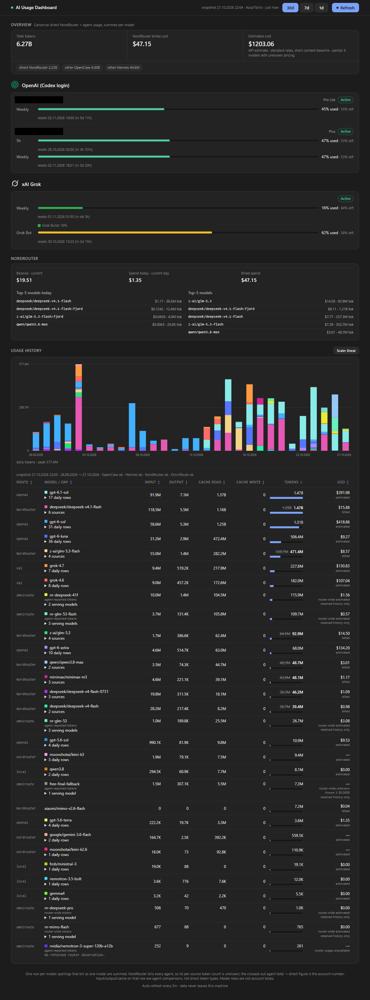

# AI Usage Dashboard

A self-hosted dashboard for AI token usage, provider quotas, and costs, based on
[grapeot/ai_usage_dashboard](https://github.com/grapeot/ai_usage_dashboard).



## What it shows

- Agent-reported model history and a separate NordRouter account-day chart, with 1-, 7-, and 30-day UTC windows.
- OpenClaw and Hermes usage, plus configured provider quota windows.
- NordRouter balance, billed spend, and top models.
- API-equivalent cost estimates, separate from billed spend.

Account-day totals have no daily model split: the dashboard never allocates them
using agent model shares. Model history uses the same measured agent rows as the
table; account history is a separate, non-additive view. Router-wide observations
remain drill-down comparisons, not replacements for agent bucket counts. When
router agent usage may overlap account billing, the combined total is unavailable
rather than double-counted. Account top-list omissions have an explicit
unattributed-model residual. Input, output, cache reads and cache writes are
separate categories; cached input is included once in total tokens.

Missing data stays unknown, not zero. If OpenClaw is unavailable, a saved window
for the same period is labelled with its original fetch time.

## Run locally

Requires Python 3.11+ and [uv](https://docs.astral.sh/uv/).

```bash
git clone https://github.com/dankarization/ai-usage-dashboard-local.git
cd ai-usage-dashboard-local
cp .env.example .env
uv venv .venv
uv pip install --python .venv/bin/python -e '.[dev]'
scripts/ai-usage-service
```

Open **http://127.0.0.1:7995/**. Run commands from the repository root.
The default listener is loopback-only; set `AI_USAGE_HOST` and `AI_USAGE_PORT`
in the launch environment if needed. Use authenticated access when exposing it
beyond your machine: usage data and account details are private.

### Configure your sources

Edit the ignored `.env`, using [.env.example](.env.example) as the reference.
Enable only the sources you use:

- **OpenClaw:** a running local Gateway and a working OpenClaw CLI.
- **Hermes:** existing native profile databases; `HERMES_HOME` can override discovery.
- **Provider accounts:** optional keys/cookies and Codex profile settings listed in `.env.example`.
- **OmniRoute:** optional `OMNIROUTE_USAGE_CONTAINER` plus `NORDROUTER_API_KEY`.
  Reuses an existing container with read-only aggregate queries; the dashboard
  user must already have Docker access. It does not start or modify the router.

Never commit `.env`, credentials, local exports, caches, logs, or unredacted
screenshots. The page uses no CDN and does not upload usage to a dashboard cloud.

## How costs are estimated

**Estimated cost** means what the available agent token categories would cost
at the model's API rates, not the price of an OAuth/subscription plan. Input,
output, cache reads, and cache writes are priced separately. Without request-level
tiers, the estimate uses a **standard short-context baseline**; a large sum of
short requests does not trigger a long-context price. Unknown tariffs or token
categories remain visibly partial, never free.

**NordRouter billed cost** comes from its account API. Agent rows routed through
NordRouter are comparison-only, so they are not billed twice. OmniRoute bucket
costs are separate router-wide estimates, not allocations to individual agents
and not additions to the overview total.

## CLI, API, and checks

```bash
scripts/ai-usage -d 7
scripts/ai-usage -d 30 --skip-desktop-chart
MPLBACKEND=Agg .venv/bin/python -m pytest tests/ -v
```

Node/npm are needed only for Codex `ccusage` exports. The optional desktop chart
and cached dashboard payload are gitignored.

- `/health` — service status.
- `/api/v1/model-breakdown?days=7` — models, estimates, and pricing coverage.
- `/api/v1/quotas` — cached provider quotas.
- `/docs` and `/openapi.json` — API endpoints and field descriptions.
- [Test and service checks](docs/test.md) — focused verification and private artifacts.

### OpenAI API billing (separate from Codex)

The OpenAI API card checks Platform credit-grant access read-only. It can reuse
`OPENAI_API_KEY` or the existing OpenClaw `openai-whisper-api` credential without
changing transcription. Ordinary project keys cannot read this browser-session
billing endpoint: the card displays the HTTP authorization blocker and unknown
balances, never a fictional $0 or a hardcoded monthly grant.

The default credit card shows the total credit bar, remaining/used dollars and
reported purchased/other balances. Grant, entitlement and verification details
are collapsed under **Billing details**. All-grant spending is not current-cycle
spending. Neither credit grants nor the documented usage/cost grouping dimensions
identify which tokens were funded by purchased versus subscription credits; no
token split is inferred from dollar proportions.

An operator-authorized Platform session can be stored outside Git in
`~/.config/ai-usage-dashboard/openai-billing.json` (directory mode `0700`,
file mode `0600`, fields `session_key`, `organization_id`, optional
`organization_name`). `OPENAI_BILLING_SESSION_FILE` overrides that path.
Symlinks and files accessible to other users are rejected. Expired sessions
produce an explicit authorization state and require reconnection.

An existing Platform billing session key can alternatively be supplied privately as
`OPENAI_BILLING_SESSION_KEY`, with `OPENAI_BILLING_ORG_ID` when needed to select
the linked organization. Do not commit session credentials or exports. A usage
admin key is not a substitute for grant identity. The authoritative `total_paid_available` field supplies purchased balance.
Aggregate credits otherwise remain unclassified: they cannot establish a ChatGPT subsidy, paid
usage, subscription cycle, or token funding split. Those fields remain unknown
until an authoritative funding-specific source is available. Verified subscription
entitlement and link metadata may be stored with their verification timestamps;
the card labels them as saved snapshots, not fresh grant allocation. Entitlement
is not treated as the prorated initial grant. Grant expiry is
not treated as a recurring reset. Organization billing is deliberately not added
to token history or overview totals, which already include local agent sessions.
