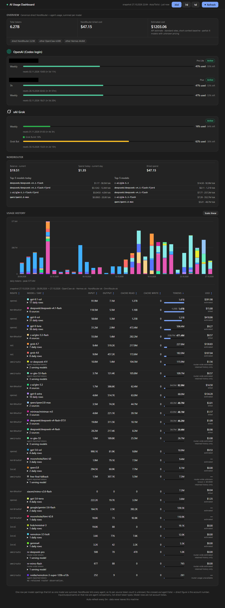

# AI Usage Dashboard (local web edition)

A self-hosted web dashboard for AI usage, quota windows, model breakdowns, and estimated cost. **This local edition is based on [grapeot/ai_usage_dashboard](https://github.com/grapeot/ai_usage_dashboard)**; that upstream project supplied the original aggregation and charting foundation. This repository adds the locally deployed FastAPI web UI and integrations described below. It is not affiliated with the providers whose data it reads.



## What it shows

- Overview: token totals, direct NordRouter tokens, OpenClaw tokens, Hermes tokens, and estimated/billed cost.
- Provider quotas: separate Codex profiles, Cursor, GLM/Z.ai, Claude, Ollama, Antigravity, Grok, and Grok Bot when configured or available.
- NordRouter: balance, spend windows, and top models from its account API.
- Usage history and model usage: 7-day or 30-day view combining OpenClaw Gateway model-day data, Hermes native session usage, and direct NordRouter account-day data. Direct NordRouter spend is canonical; both agents' NordRouter-routed rows remain comparison-only (crossed out) to avoid double counting. Every row names the agent that reported it.
- Terminal table and optional desktop matplotlib chart from `auto_usage.py`.

Missing/unknown values stay unavailable rather than being shown as zero. Collection reads local logs/caches and configured provider APIs; it does not upload usage data to a dashboard cloud service. When the OpenClaw Gateway cannot be read live, the last successful saved window for that same period is shown with its original fetch time and an explicit stale label rather than as current data.

## Run locally

Requires Python 3.11+, `uv`, and Node/npm for Codex `ccusage` exports.

```bash
git clone https://github.com/dankarization/ai-usage-dashboard-local.git
cd ai-usage-dashboard-local
cp .env.example .env
uv venv .venv
uv pip install --python .venv/bin/python -e '.[dev]'
scripts/ai-usage-service
```

Open `http://127.0.0.1:7995/` or `/dashboard`. The page is self-contained and uses no CDN. `scripts/ai-usage-service` defaults to loopback on port 7995; configure `AI_USAGE_HOST` and `AI_USAGE_PORT` privately if another device needs access. On this deployment, a user systemd service runs `local_display_service:app` from this checkout on port 7995.

`cp .env.example .env` creates a private, ignored configuration file. Enable only sources you use. Local Codex, Claude Code, and OpenCode logs need no API key. Optional variables include `CODEX_HOME_2` and profile labels, `CURSOR_COOKIE`, `GLM_BEARER_TOKEN`, `GROK_COOKIE`, `OLLAMA_COOKIE`, `NORDROUTER_API_KEY`, `OPENCODE_BATCH_DB`, and `AI_USAGE_OPENCODE_SKILL_PATH`. Never commit credentials or generated exports.

For a terminal report or desktop chart:

```bash
scripts/ai-usage -d 7
scripts/ai-usage -d 30 --skip-desktop-chart
```

The collector writes a private `token_usage_eink.json` cache used by the web service (a legacy filename, not a hardware requirement). The optional chart is `token_usage_dashboard.png`. Both are gitignored.

## Web/API contract

| Endpoint | Purpose |
| --- | --- |
| `GET /` or `/dashboard` | Web dashboard |
| `GET /health` | Service liveness |
| `GET /token_usage.json` | Cached full dashboard payload |
| `GET /api/v1/quotas` | Cache-only provider quota windows (unchanged default) |
| `GET /api/v1/quotas?source=codex\|grok\|grok_bot` | Fetch one provider's quota live without waiting for other providers or the full refresh |
| `GET /api/v1/model-breakdown?days=7&daily=true` | Model and daily usage; `days=30` and `source=all` are the API defaults. `source=openclaw`, `source=hermes`, `source=nordrouter`, or `source=omniroute` isolates one source. |
| `POST /api/v1/display/update` | Serialized full refresh; the page uses it on open, every five minutes, and on Refresh |
| `POST /api/v1/antigravity/ingest` | Optional cross-machine Antigravity entry ingest |

The page shares a 1d/7d/30d selector across overview, history, and model usage (7d by default). Usage history opens with a linear token axis; its Scale button can switch to balanced visual weighting. The page requests cached quotas, live Codex/Grok/Grok Bot quotas, direct NordRouter usage, and OpenClaw usage independently so ready sections appear before the full provider refresh finishes; a failed source leaves already displayed data intact. The 1d view covers the current local calendar day, from midnight to now; NordRouter's selected-window billed spend comes from the matching model-breakdown response. Quota reset windows and today's NordRouter figures retain their own periods.

### API-equivalent estimates

**Estimated cost** answers “what would these agent tokens cost at API rates?”,
not what a subscription or OAuth account was charged. The server prices each
model's uncached input, output, cache reads and cache writes once, using the exact
shared tariff in `pricing_config.py`. Stored Gateway dollar estimates (including
positive partial costs and zero placeholders) never replace this calculation.
Hermes uses its own token categories, not another source's average cost per token.
The browser displays the server results without a second pricing formula.

For aggregated usage without request-level billing tiers the policy is **standard
rates, short-context baseline**. Summing many requests past a context threshold
never selects a more expensive tier. A context capacity suffix such as `-900k`
does not prove that any request used long context. Explicit recognized fast model
IDs retain their documented tariff; unknown model variants are not guessed.
OpenAI baseline rates were checked against
[official API pricing](https://developers.openai.com/api/docs/pricing) on 2026-10-27;
the new exact GPT-6/6.1 IDs extend the existing audited table. Recognized OpenAI
fast variants use explicitly verified multipliers (including GPT-5.5 at 2.5x);
GPT-5.4-mini-fast uses the now-published $1.50/$9/$0.15 API rates rather than
the older exporter alias's standard price. Legacy exporters remain unchanged.

API rows expose `api_pricing` (identity, rates, reference, USD/million-token unit,
baseline), `priced_tokens`, `unpriced_tokens`, and `unpriced_categories`.
`cost_usd` is the known API-priced category sum; `cost_kind=partial` identifies
incomplete coverage, and it is null when nothing is priceable. A row with a known
subtotal counts in both `priced_models` and `unpriced_models`; source `complete`
continues to mean data availability, not complete tariff coverage. Unknown tariffs
or categories never mean free usage; explicit local/free routes can still cost $0.

Gateway model-day records expose only total tokens, not daily token categories.
Their daily API dollars are therefore unavailable; no partial native dollars or
invented average-rate split is mixed into the window estimate. Hermes daily
categories can be priced. Token history and saved raw usage remain unchanged.

NordRouter remains a separate **billed** account total. Its agent comparison
rows and non-additive OmniRoute router-wide observations are never added to the
agent estimate. An unidentified agent bucket is unpriced, not a false $0;
router-wide serving prices are not allocated to an individual agent.

### OpenClaw saved window

A page load or a manual Refresh still attempts the live Gateway read first. When
that read succeeds, the requested window (1d, 7d, or 30d with its local calendar
dates) is also saved as one row in the dashboard-owned SQLite database, holding
only the aggregate fields the dashboard projects.

### The dashboard database

The dashboard owns one SQLite file: the gitignored `data/dashboard.sqlite`,
created on first write with `PRAGMA journal_mode=WAL`, a bounded busy timeout,
and `0600` permissions for the dashboard user. It is the dashboard's own store: the OpenClaw Gateway's state database, Hermes `state.db`, and the
OmniRoute container's `storage.sqlite` are never read or written here.

The schema is additive and versioned. `schema_meta` records the owning
application and the schema version, so a later release can add tables without a
breaking change, and `openclaw_usage_snapshot` holds one row per saved window:

| column | meaning |
| --- | --- |
| `window_key` | primary key: the exact period, e.g. `days=7;start=2026-10-20;end=2026-10-26` |
| `days`, `start_date`, `end_date` | the requested window, so a row can be checked before use |
| `fetched_at_utc` | the original **successful** live fetch time |
| `payload` | the projected aggregate (JSON) |

Two rules keep the file safe to share with a future version and with anything
else on the machine. A database that is foreign (no dashboard marker), corrupt,
or written by a newer schema is refused untouched — the source degrades to an
honest `unavailable` rather than repairing or overwriting a file this dashboard
does not own. And every write is a single transaction, so a second process or a
concurrent page refresh cannot leave a half-written window behind.

`AI_USAGE_DASHBOARD_DB` sets the database file explicitly, and
`OPENCLAW_USAGE_CACHE_DIR` (kept for compatibility) sets its directory;
`*.sqlite` snapshots written before the database existed are imported once on
first read and left in place. Tests use both to stay off the live database. The
service itself needs no new configuration.

When the Gateway is unavailable, errors, or exceeds its bounded wait, the
saved window for exactly that period is served instead of an error page or a
fabricated zero. `meta.openclaw_status` becomes `cached`, `meta.openclaw_cached_at_utc`
carries the original successful fetch time, and `meta.openclaw_error` carries a
bounded failure summary; the page shows all three in its warning banner and
labels `sources.openclaw` as incomplete, so a saved window is never presented as
the current canonical total. A failed read never rewrites the stored window and
never advances its fetch time. A different window — including yesterday's 1d
window on a new local day — is not reused; with no saved window for the
requested period the source reports an honest `unavailable`.

Only a successful live read performed for the page writes this store: there is
no scheduled collector, background poller, or new timer.

### OpenClaw CLI selection

The Gateway read uses the CLI that owns the running Gateway rather than the
newest-looking file on disk. Candidates are tried in order — `OPENCLAW_USAGE_CLI`
if set, then the runtime's own shim, then installations in semantic version
order — and the first one that returns a valid aggregate wins and is memoized
for the process. Lexicographic ordering used to put an older build first, and
that build cannot open current Gateway data at all (`newer-schema`). The whole
lookup shares one deadline, so a hung or broken candidate can never stretch a
page load into a multi-minute wait; if none works, the source is honestly
`unavailable`.

`GET /api/v1/quotas` without a source does not force a provider refresh; it uses the in-memory or on-disk cache. Other provider quotas in this aggregate retain that cache freshness rather than separate live polling. Response models and field descriptions are defined in `dashboard_models.py` and available at `/openapi.json`. `scripts/push-antigravity` can send local entries from a separately configured satellite machine.

## Optional OmniRoute bucket costs

Set `OMNIROUTE_USAGE_CONTAINER` in the private `.env` to the name of an existing
local OmniRoute container. The dashboard user must already have Docker access;
this integration does not create containers, change permissions, or modify the
router. It uses `docker exec` and the container's existing `better-sqlite3` to
query `/app/data/storage.sqlite` in read-only/query-only mode. The companion
`scripts/omniroute-aggregate.cjs` must remain alongside the repository modules.
There is no new poller or scheduler. One aggregate-only, locked snapshot serves
all selected windows for five minutes, including failure backoff. Failed reads
retain an explicitly stale snapshot or show unavailable; the rest of the page
loads independently.

In **Usage history**, a bucket's USD is the sum of its **observed serving
attempts**, each priced at its exact current NordRouter retail tariff using
`NORDROUTER_API_KEY`. Unused fallback candidates contribute nothing. Failed
attempts with consumed tokens count too; shared correlation IDs are not dedup
keys. Outer combo response logs are excluded. Prompt input includes cached
tokens in this router schema: input is prompt minus cache-read/cache-write,
then each category is charged once. Missing optional cache counters mean zero;
invalid counters or missing active-category tariffs leave cost unknown.
Exact provider/model IDs, routing suffixes, and versions are preserved for
pricing and drilldown. Other providers without a verified tariff remain unknown.

Expand a bucket to inspect serving routes with their tokens and USD, then a day
to inspect only that day's routes. The table retains **agent-reported tokens**
where available; router-wide tokens are explicitly labelled and shown in the
drilldown. USD is **router-wide estimated cost**, not a per-agent allocation or
historical invoice. A bucket without an agent row is labelled router-wide.
These observations are non-additive: the existing NordRouter account/model
rows remain separate and unchanged, including mixed direct/router traffic.
Do not sum those account rows with bucket observations or subtract estimates
from billed account spend. Overview **Estimated cost** uses the API-equivalent policy above;
router prices/coverage are never added to them.

Only retained historical `combo_name`/execution paths establish bucket
membership: current fallback candidates never reconstruct past membership or
renames. The response exposes retention/freshness, known partial USD and
unpriced serving counts. A full cost is unavailable if any used route has no
exact tariff; known cost is a lower bound. Earliest retained timestamps cannot
prove there were no deleted gaps (`history_complete=false`). Provider origin
classification uses current connection base-URL metadata; deleted/ambiguous
connections remain unpriced, and historical endpoint changes cannot be proven.
The inclusive local calendar window is converted to half-open UTC bounds in
Asia/Tbilisi. No prompts, responses, credentials, API-key identifiers, or
request correlation IDs are selected/exported. Pricing has a separate cache
budget so it cannot consume existing analytics refresh slots.

## Verification and privacy

```bash
.venv/bin/python -m pytest tests/ -v
.venv/bin/python -c "import tomllib; tomllib.load(open('pyproject.toml','rb'))"
curl -fsS http://127.0.0.1:7995/health
```

This source repository is public. Keep credentials and local usage data out of Git: `.env`, local source exports, dashboard payloads, charts, caches, logs, and temporary files are ignored. The committed screenshot contains no account email addresses or image metadata. The unredacted original is not part of this repository. The historical `eink/` firmware and simulator from upstream are not used by this web deployment and have been removed from the current tree; the cache/API names remain for compatibility with the live UI.

See [docs/test.md](docs/test.md) for focused service checks.
